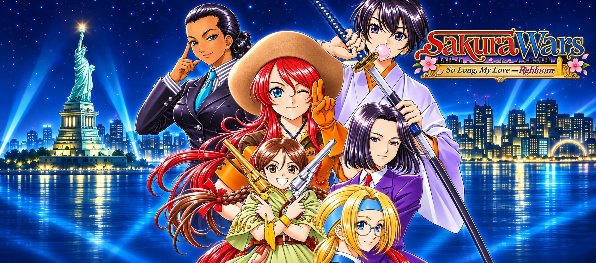
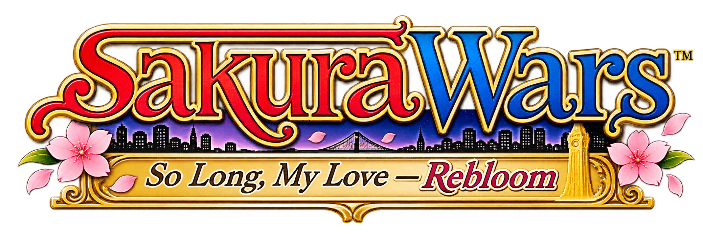
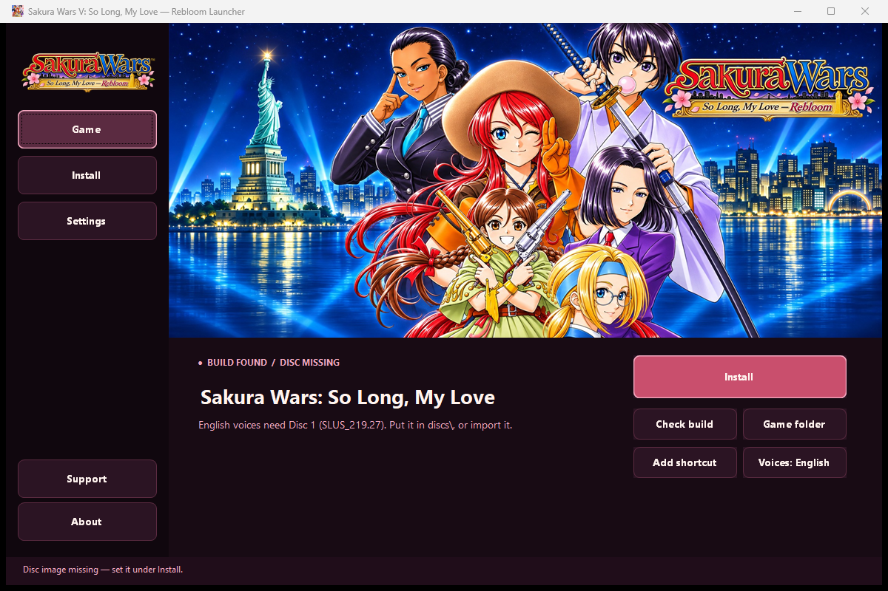
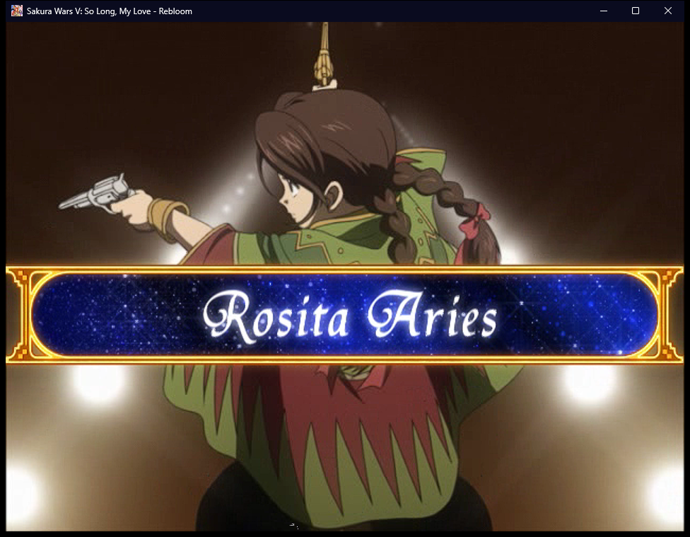

<p align="center"></p>
<p align="center"></p>

<p align="center"><strong>Sakura Wars: So Long, My Love, rebuilt to run natively on PC and mobile.</strong><br>
PlayStation 2 code translated to native C++ — no emulator, no BIOS — for Windows, Linux, Android and iOS.</p>

<p align="center"><a href="https://github.com/dea7hsmiless/Sakura-Wars-So-Long-My-Love-Rebloom/releases">Releases</a> · <a href="RELEASE-HANDOFF.md">Test notes</a> · <a href="#build-from-source">Build from source</a></p>

# Sakura Wars: So Long, My Love — Rebloom

A native recompilation of **Sakura Wars: So Long, My Love** (PlayStation 2) for Windows,
Linux, Android and iOS. The game's own PS2 code is translated to C++ ahead of time and compiled
into a normal program. No emulator and no BIOS are involved.

The game's CD/DVD server, its sound engine (`Sakuya 2`) and the CRI ADX driver run as guest code
on an interpreted IOP; only disc reads and module loading are answered by the host runtime.

**Bring your own discs. No disc image, game data, saves, soundtrack or extracted files are
included.** This is an unofficial fan project.

## Screenshots

| | |
| --- | --- |
|  |  |
| **Rebloom Launcher** — Sakura palette, key art and five-page rail. | **In game** — the recompiled PS2 renderer at 1080p. |

## Which discs do I need?

- **Disc 1** — `SLUS_219.27`, English voices.
- **Disc 2** — `SLUS_219.30`, Japanese voices.

The two discs differ by 28 bytes, so one build plays either. Import both to switch voice tracks
freely. The launcher copies the ISO into its own `discs/` folder and verifies the serial.

## Downloads

Get the latest packages from [Releases](https://github.com/dea7hsmiless/Sakura-Wars-So-Long-My-Love-Rebloom/releases).

| Platform | Download | Requirements |
| --- | --- | --- |
| Windows | [Rebloom-0.1-Windows-x86_64.zip](https://github.com/dea7hsmiless/Sakura-Wars-So-Long-My-Love-Rebloom/releases/latest/download/Rebloom-0.1-Windows-x86_64.zip) | Windows 10/11 x64; Direct3D 12 or Vulkan; your own disc |
| Linux | [Rebloom-0.1-x86_64.AppImage](https://github.com/dea7hsmiless/Sakura-Wars-So-Long-My-Love-Rebloom/releases/latest/download/Rebloom-0.1-x86_64.AppImage) | x86-64, glibc 2.39+, Vulkan 1.1, X11 or Wayland |
| Linux alternative | [Rebloom-0.1-Linux-x86_64.tar.gz](https://github.com/dea7hsmiless/Sakura-Wars-So-Long-My-Love-Rebloom/releases/latest/download/Rebloom-0.1-Linux-x86_64.tar.gz) | Same AppDir package for systems that cannot run an AppImage |
| Android | [Rebloom-0.1-android-arm64.apk](https://github.com/dea7hsmiless/Sakura-Wars-So-Long-My-Love-Rebloom/releases/latest/download/Rebloom-0.1-android-arm64.apk) | Android 9+ arm64; Vulkan GPU with 7+ storage buffers; debug-signed sideload |
| iOS | [Rebloom-0.1-ios-unsigned.ipa](https://github.com/dea7hsmiless/Sakura-Wars-So-Long-My-Love-Rebloom/releases/latest/download/Rebloom-0.1-ios-unsigned.ipa) | iOS 16.4+ arm64; unsigned — sign with your own certificate |

[SHA256SUMS.txt](https://github.com/dea7hsmiless/Sakura-Wars-So-Long-My-Love-Rebloom/releases/latest/download/SHA256SUMS.txt)
is attached to every release. The Windows zip also contains the full rebuild source.

## Quick start

1. Download the package for your platform.
2. Import your own **Disc 1** ISO. Import **Disc 2** as well for Japanese voices.
3. Press **Play**.

### Windows

Extract the zip anywhere and run `Rebloom Launcher.exe`. Use **Install → Import disc image**
(the **Install** button works when no disc is present). The ISO is copied into `discs\`, so the
source file can be deleted. A dragged `.iso` works too. Disc 2 is 7.17 GB, so use NTFS or exFAT,
not FAT32.

### Linux

Extract the tar.gz, or mark the AppImage executable and run it. Open **Install** and import your
Disc 1 ISO. The AppImage keeps discs, saves and settings in `~/.local/share/rebloom` (or
`REBLOOM_HOME`). The game links against the system Vulkan loader; SDL2 is bundled.

### Android

Sideload the APK, open **Rebloom**, press **Import disc...**, and choose your ISO. The file is
copied into app storage, so the source can be deleted. The on-screen pad starts at **1× internal
resolution**; **Settings → Controls** changes the pad, haptics, colour and opacity, and
**Settings → Display** changes resolution and 16:9 / 4:3 / Fill.

### iOS

Sign the unsigned IPA with your own certificate (Sideloadly, AltStore, or Xcode) and install it.
Open **Rebloom**, import Disc 1 through the Files picker, and press **Play**. Delete an older
Rebloom install first so iOS does not keep cached assets. The on-screen pad, haptics and
tap-to-advance switch live under **Settings → Controls**.

## Features

- Boot, health screen, memory-card format, save and load
- Title menu, New Game, the opening film, and the opening chapter's dialogue
- Disc 1 and Disc 2 support, with one memory card per voice language
- 60 fps at 1080p on an RTX 3070 with about 14% CPU use
- Keyboard and gamepad bindings edited inside the launcher; the game re-reads them within a second
- Internal resolution 1×–4×, aspect 4:3 / 16:9 / Fill, picture looks, edge smoothing, temporal de-dither
- Windows/Linux launcher: five-page rail, Sakura palette by default, **Classic (gold)** option
- Android/iOS: real analog stick, button and stick haptics, touch colour and opacity, on-screen
  controls On/Off, optional tap-to-advance, 16:9 / 4:3 / Fill, Bluetooth controllers
- Android/iOS launcher: sharp full-bleed key art and 1× internal resolution by default
- No telemetry. Nothing is uploaded.

## Settings and defaults

Settings live in `launcher.ini` beside the launcher (Windows/Linux) or `rebloom.ini` in the app's
Documents folder (Android/iOS). Game bindings are in `game/data/keys.ini` and `gamepad.ini`.

Windows/Linux defaults: fullscreen + exclusive, 16:9, 3× internal resolution, Crisp + edges,
deinterlace off, VSync fifo, frame latency 2, Direct3D 12, temporal de-dither on.
Android/iOS default to **1× internal resolution**.

**F1** opens the port menu (quick save/load, picture look, aspect, resolution, keys, quit).
**F11** toggles full screen. On mobile, the same options are under **Settings**.

## Known limitations

- **Battles are untested.** Only the opening dialogue has been played.
- **Audio has not been judged by ear.** The sound chip produces real output; nobody has listened
  to the full mix.
- `16:9` is a presentation stretch. There is no verified Hor+ widescreen patch for this disc.
- **2×/3× upscaling on Windows** can show jagged edges or a ghost trail during fades; **1× is
  clean**. Mobile defaults to 1×. A fix is planned for a later release.
- Android has not been run on a physical phone; the host-GPU emulator is the only device test.
  The iOS launcher and game boot on iPhone, but touch/haptics and later scenes remain under test.
- The iOS IPA raises Metal's storage-buffer limit to eight (the GS pass needs seven), capped at
  the adapter limit.
- HD texture overrides are supported; no texture pack is included.

## Build from source

The Windows package contains the translated C++ and full rebuild notes:
`Rebloom-0.1-Windows-x86_64/source/`. The launcher is a single C# file compiled by the .NET
Framework 4 `csc.exe` that ships with Windows.

```powershell
powershell -NoProfile -ExecutionPolicy Bypass -File Rebloom-0.1-Windows-x86_64/source/Build-Launcher.ps1 -NoShortcut
```

Linux launcher (PyInstaller, from WSL/Linux):

```bash
cd /root/rebloom && ./venv/bin/pyinstaller --noconfirm \
  --distpath dist --workpath pyi "pyi/Rebloom Launcher.spec"
```

Android (arm64, NDK 30, JDK 21):

```powershell
cd mobile/android
java -classpath gradle/wrapper/gradle-wrapper.jar org.gradle.wrapper.GradleWrapperMain --no-daemon assembleDebug
```

iOS (unsigned IPA, from Windows with the iPhoneOS SDK and Swift clang):

```powershell
python mobile/ios/build_ios.py
```

Build details are in `Rebloom-0.1-Windows-x86_64/source/REBUILD.md`,
`BUILDING.md` and `RESULTS.md`.

## Verify your download

Download `SHA256SUMS.txt` next to your package.

Windows (PowerShell):

```powershell
Get-FileHash .\Rebloom-0.1-Windows-x86_64.zip -Algorithm SHA256
```

Linux:

```sh
sha256sum -c SHA256SUMS.txt --ignore-missing
```

The repository also includes `Verify-Rebloom.ps1`.

## Credits

- **ps2-native-recomp** by exoteric33 — the recompiler and runtime.
- **ps2-web-recomp** by Samir Nuri — the code generator underneath it.
- **wgpu-native**, **SDL2**, **DirectX Shader Compiler**, **pycdlib** — see `THIRD-PARTY.md`.
- Launcher design follows the ReDUB launcher's model.

## Legal

Fan project. Not affiliated with Sega or Red Entertainment. Sakura Wars and all related names,
characters, art and music belong to their owners. No game content is distributed here. The key
art and logo are used only to identify this non-commercial fan project. You must own the discs to
use the port.
