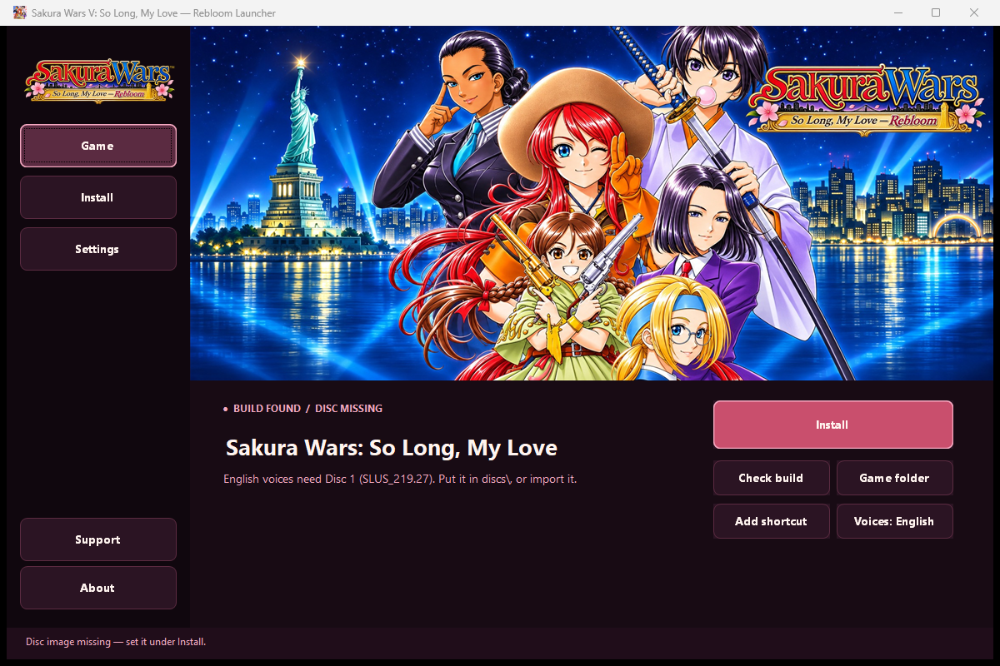
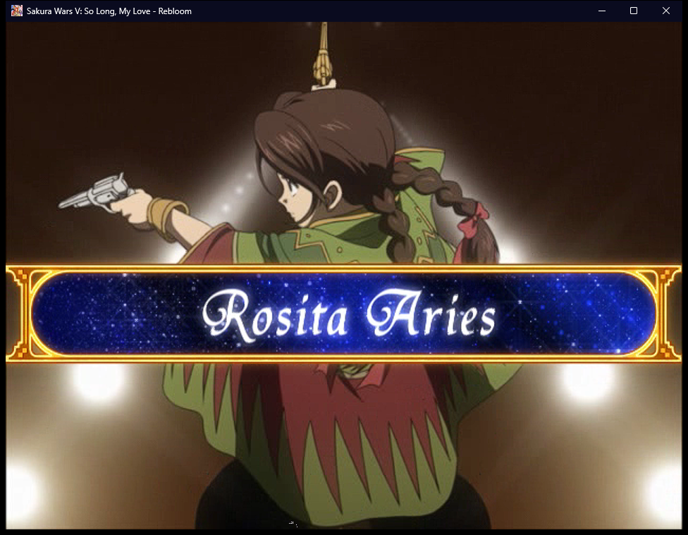

A native Windows build of **Sakura Wars V: So Long, My Love** (PlayStation 2), made by static
recompilation. This package contains the port only; **you need your own discs.**

The game's own PlayStation 2 code is translated to C++ ahead of time and compiled into a
normal Windows program. No emulator and no BIOS are involved. The game's CD/DVD server, its
sound engine (`Sakuya 2`) and the CRI ADX driver all run as guest code on an interpreted IOP;
only disc reads and module loading are answered by the runtime.

## Screenshots

## Downloads

| File | Size | Requirements |
| --- | --- | --- |
| Rebloom-0.1-Windows-x86_64.zip | 44.7 MB | Windows 10/11 x64, Direct3D 12 or Vulkan, your own disc image |

SHA-256: `a1d62fc36a8b658cf309a832e44521bc71ebc5d8dc7d92af6dcf683b150595ff`

Also in the release: `SHA256SUMS.txt`, the two screenshots above, and the launcher source inside the zip under `source\`.

## What works

- Boot, health screen, memory-card format, save and load
- Title menu, New Game, the opening film, and the opening chapter's in-game dialogue
- Disc 1 (`SLUS_219.27`, English voices) and Disc 2 (`SLUS_219.30`, Japanese voices) — the two
  discs differ by 28 bytes, so one build plays either
- 60 fps at 1080p on an RTX 3070 with about 14% CPU use

## What is not done yet

- **Battles are untested.** Only the opening dialogue has been played.
- **Audio has not been judged by ear.** The sound chip produces real output, but nobody has
  listened to it.
- The in-game menu's new `Aspect` row has been checked by hand once.
- `16:9` is a presentation stretch. PCSX2 has no patch for this disc's CRC (`5AC9154D`), so true
  Hor+ widescreen needs a game patch.
- Texture filtering/AA in the launcher covers the runtime's Crisp/Soft/Sharp looks and smooth-edge
  AA; no separate MSAA/anisotropic path yet.
- HD texture overrides are supported, but no texture pack is included.

## Install

1. Extract the zip anywhere, for example `C:\Games\Rebloom`.
2. Press **Install → Import disc image** (the **Install** button does this when no disc is present).
   It copies the ISO into `discs\`, so the original can be deleted. Import **Disc 1** for English
   voices and **Disc 2** as well for Japanese voices. A dragged `.iso` works too. Disc 2 is
   7.17 GB, so use NTFS or exFAT, not FAT32.
3. Run `Rebloom Launcher.exe` (or `Launch Rebloom.cmd`) and press **Play**.

To skip the launcher next time, choose **Settings → Game → When opened → Play immediately**.
Hold **Shift** while opening it (or use `--launcher`) to show the window again. Settings → Graphics
has **Performance/Quality** presets, **Picture look** with smooth-edge AA, and an optional **HD
textures** folder.

Settings live in `launcher.ini` beside `Rebloom Launcher.exe`; the game's own keys and resolution live in
`game\data\keys.ini`. Delete `launcher.ini` to go back to defaults.

## Notes

- The launcher writes one memory card per voice language (`play-english.ps2`,
  `play-japanese.ps2`), so switching discs never overwrites the other save.
- **F1** opens the port's menu: quick save/load, picture look, aspect, resolution, keys, quit.
  **F11** is full screen. The controller chord for the menu is off by default; turn it on under
  Settings → Advanced if you play with a pad.
- Settings → Display offers **Borderless** full screen (default, keeps the desktop mode) or
  **Exclusive** full screen (changes the display mode).
- The game window's title bar is just the game name; the title bar and taskbar use the key art.
- Logs: the launcher's under Support; the game's in `game\data\logs\`.

## Updating

Replace the folder, keeping `discs\`, `game\data\` and `launcher.ini` if you want your saves and
settings. Nothing is downloaded or installed outside this folder.

## Credits

- **ps2-native-recomp** by exoteric33 — the recompiler and runtime this build uses.
- **ps2-web-recomp** by Samir Nuri — the code generator underneath it.
- **wgpu-native**, **SDL2**, **DirectX Shader Compiler**, **pycdlib** — see `THIRD-PARTY.md`.
- Launcher design follows the ReDUB launcher's model.

Fan project. Not affiliated with Sega or Red Entertainment. Sakura Wars and all related names,
characters, art and music belong to their owners. No game content is distributed here. The key
art and logo are used only to identify this non-commercial fan project.
